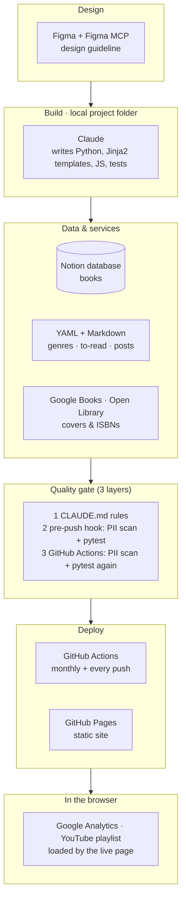
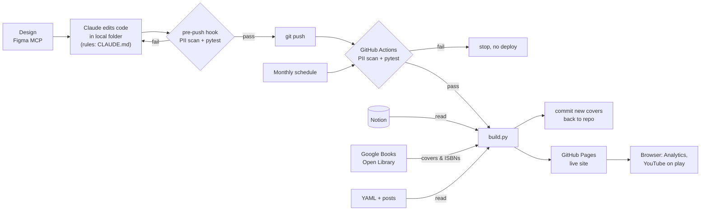

# Maude's Library

A personal reading log, published as a static website: **https://maudes.github.io/library/**

## Why

I read a lot and wanted one place to keep it all: what I've read, how I rated it,
what my taste looks like, and what to read next. Notion is where I already log
books, so it stays the single source of truth. This project turns that database
into a public website that updates itself.

## Site structure

| Page | What it is |
|---|---|
| **Library** (`/`) | Every book I've read, with covers, ratings, summaries and stats. Browse as a list or cards; sort and filter. |
| **Taste** (`/taste/`) | Genre breakdown, top picks, a to-be-read list and "what to read next" suggestions. |
| **Blog** (`/blog/`) | Longer reading notes, written in Markdown. |
| **Doodles** (`/doodles/`) | Drawings, grouped in series (30 Days Challenge, 少女摩門特), with a lightbox viewer. |

## How it works

Two views of the same system: the **stack** (what it is built from) and the
**flow** (how a change reaches the live site).

### Stack

### Flow

- **Design:** layout and style are designed in Figma and handed to Claude through
  the **Figma MCP** server.
- **Build:** Claude writes the **Python** site generator. `build.py` reads the
  **Notion database**, computes stats and rankings, and renders plain HTML with
  **Jinja2**. Browser JavaScript only handles sorting, filtering, the lightbox and
  the playlist.
- **Third-party services:** Notion (book data), Google Books and Open Library
  (covers and ISBNs, cached in the repo), Google Analytics and a YouTube playlist
  (loaded in the visitor's browser).
- **Guardrails:** three layers, each stricter than the last.
  1. `CLAUDE.md` tells Claude the project rules in every new chat.
  2. A **pre-push hook** runs `scripts/check.sh` (PII/secret scan, then `pytest`)
     and blocks the push if anything fails.
  3. **GitHub Actions** runs the same scan and tests again before every deploy.
  If any layer fails, nothing is published.
- **Deploy:** **GitHub Actions** rebuilds on the 1st of every month and on every
  push, then publishes to **GitHub Pages**. API keys live in GitHub Secrets.

## How I work with Claude

I keep one local project folder as the parent. Claude works in it one area at a
time, and each area maps to a part of the site.

| Workstream | What happens |
|---|---|
| **Design** | Finalize the look in Figma and release it as a design guideline via Figma MCP. Every later step follows it. |
| **Main page** | Library page: list/card views, stats, sorting. |
| **Taste** | Genre chart, to-be-read list, read-next suggestions. |
| **Blog** | Reading notes in Markdown. |
| **Doodles** | Drawing series and lightbox. |
| **Maintenance** | Monthly refresh from Notion, cover/ISBN fixes, updates to the YAML files. |

## Technical structure

Which file does what, and which page it serves.

| Path | Role | Serves |
|---|---|---|
| `build.py` | Entry point: runs the whole pipeline | All |
| `config.py` | Notion column names, genres, settings | All |
| `src/notion_source.py` | Reads Notion (or CSV), cleans and validates rows | Library |
| `src/enrich.py` | Cover and ISBN lookup (Google Books → Open Library), cached | Library, Taste |
| `src/stats.py` | All counts, averages, rankings and sort orders | Library |
| `src/taste.py` | Genre ratio, to-read list, "read next" | Taste |
| `src/posts.py` | Reads `posts/*.md` | Blog |
| `src/doodles.py` | Turns `static/doodles/<series>/` images into series, makes thumbnails | Doodles |
| `src/render.py` | Writes `site/` with Jinja2 | All |
| `templates/` | HTML templates | All |
| `static/` | `style.css`, JavaScript, covers, doodle images | All |
| `posts/` | Reading-note Markdown files | Blog |
| `data/` | Hand-edited YAML (genres, to-be-read, picks) and the cover/ISBN cache | Taste, Library |
| `scripts/` | PII/secret scan and the pre-push check | All |
| `.githooks/` | Git pre-push hook that runs those checks | All |
| `CLAUDE.md` | Project rules Claude loads in every new chat | — |
| `tests/` | `pytest` suite, run before every deploy | — |
